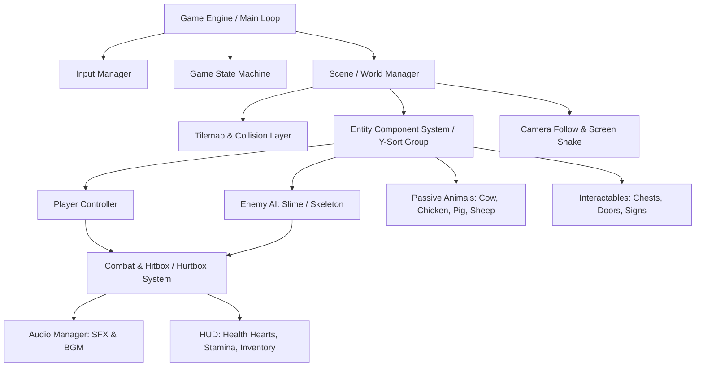

# 🎮 MASTER PROMPT — CUTE FANTASY RPG
*Comprehensive Architectural Specification, Asset Pipeline & Production Directive*

---

## 1. Project Overview & Identity
- **Title**: Cute Fantasy RPG
- **Genre**: 2D Top-Down Action RPG / Adventure & Exploration
- **Visual Style**: Cute 16-bit Pixel Art (16x16 tile grid, 32x32 character sprites)
- **Target Experience**: Cozy exploration meets crisp, responsive real-time combat (inspired by *The Legend of Zelda: The Minish Cap*, *Secrets of Mana*, and *Stardew Valley*).
- **Core Loop**: 
  $$\text{Explore World} \longrightarrow \text{Defeat Monsters \& Loot} \longrightarrow \text{Interact \& Upgrade} \longrightarrow \text{Unlock New Areas}$$

---

## 2. Asset Catalog & Technical Breakdown

### A. Grid & Dimension Standards
* **Base World Tile**: $16 \times 16 \text{ px}$
* **Character Frame Size**: $32 \times 32 \text{ px}$ (Standard entity hitbox: $12 \times 16 \text{ px}$)
* **Virtual Resolution**: $320 \times 180 \text{ px}$ (Native 16:9 pixel-perfect scale, e.g. 4x zoom to 1280x720, 6x to 1920x1080)

### B. Graphics & Animation Mapping
All assets reside in `assets/Cute_Fantasy_RPG_Assets/Graphics/`:

| Asset File | Resolution | Grid / Slice | Animations & Usage |
| :--- | :--- | :--- | :--- |
| **Player.png** | $192 \times 320$ | 6 cols $\times$ 10 rows ($32 \times 32$) | Idle (4 dirs, 6 frames), Walk (4 dirs, 6 frames), Hurt & Death animations |
| **Player_Actions.png** | $96 \times 576$ | 3 cols $\times$ 18 rows ($32 \times 32$) | Sword Slash combos, Dash / Dodge, Tool swings, Charge attacks |
| **Skeleton.png** | $192 \times 320$ | 6 cols $\times$ 10 rows ($32 \times 32$) | Undead Enemy: Idle, Walk/Chase, Melee Attack, Hurt, Bone Collapse Death |
| **Slime_Green.png** | $512 \times 192$ | 16 cols $\times$ 6 rows ($32 \times 32$) | Monster: Squish Idle, Hop/Move, Tackle Attack, Splat Hurt, Dissolve Death |
| **Chicken.png** | $64 \times 64$ | 4 cols $\times$ 4 rows ($16 \times 16$) | Farm Animal: Idle peck, 4-direction wander |
| **Cow.png** | $64 \times 64$ | 2 cols $\times$ 2 rows ($32 \times 32$) | Farm Animal: Chew grass, slow wander |
| **Pig.png** | $64 \times 64$ | 2 cols $\times$ 2 rows ($32 \times 32$) | Farm Animal: Snout idle, trot wander |
| **Sheep.png** | $64 \times 64$ | 2 cols $\times$ 2 rows ($32 \times 32$) | Farm Animal: Graze idle, fluffy wander |
| **Tilesets** | Various | $16 \times 16$ Sub-tiles | `Beach_Tile`, `Cliff_Tile`, `FarmLand_Tile`, `Grass_Middle`, `Path_Tile`, `Water_Tile` (Auto-tile / 9-slice terrain) |
| **House_1_Wood_Base_Blue.png** | $96 \times 128$ | $6 \times 8$ tiles ($16 \times 16$) | Village building with entrance doorway & roof layer |
| **Oak_Tree.png** / **Small** | $64 \times 80$ / $96 \times 48$ | Multi-tile ($16 \times 16$) | Tree foliage with depth sorting (Y-sorting base collision) |
| **Chest.png** | $16 \times 16$ | Single tile / frame | Treasure chest (Closed $\to$ Open transition) |
| **Outdoor_Decor_Free.png** | $112 \times 192$ | Sheet ($16 \times 16$) | Rocks, flowers, signs, stumps, mushrooms |
| **Bridge_Wood.png** & **Fences.png** | $144 \times 64$ & $64 \times 64$ | $16 \times 16$ segments | Crossable water bridges, boundaries & pen enclosures |

### C. Audio Mapping (BGM & Sound Effects)
All files reside in `assets/Cute_Fantasy_RPG_Assets/Audio/`:

| Sound ID / File | Category | Trigger Event | Behavior / Details |
| :--- | :--- | :--- | :--- |
| `Music/Fair_Fight_(Battle).wav` | BGM | Combat / Dungeon / Overworld | Seamless loop, volume ducking during dialogue |
| `Sound_Effects/07_human_atk_sword_1..3.wav` | SFX | Player Light Attack | Random rotation (pitch variation $\pm 5\%$) |
| `Sound_Effects/26_sword_hit_1..3.wav` | SFX | Sword connects with enemy | Hit pause (3 frames), camera shake |
| `Sound_Effects/27_sword_miss_1..3.wav` | SFX | Attack misses | Soft air swoosh |
| `Sound_Effects/08_human_charge_1..2.wav` | SFX | Holding attack button | Charging aura audio loop |
| `Sound_Effects/10_human_special_atk_1..2.wav`| SFX | Releasing charged spin/slam | High damage area attack |
| `Sound_Effects/15_human_dash_1..2.wav` | SFX | Spacebar / Dash key | Quick evasion with i-frames |
| `Sound_Effects/11_human_damage_1..3.wav` | SFX | Player hit by enemy | Red flash, 0.5s invulnerability |
| `Sound_Effects/14_human_death_spin.wav` | SFX | Player HP reaches 0 | Game over sequence |
| `Sound_Effects/16_human_walk_stone_1..3.wav`| SFX | Movement on path / stone | Step cadence linked to walk animation frame 1 & 4 |
| `Sound_Effects/21_orc_damage_1..3.wav` | SFX | Monster / Skeleton hit | Enemy stagger feedback |
| `Sound_Effects/24_orc_death_spin.wav` | SFX | Monster defeated | Enemy disintegration / loot drop |
| `Sound_Effects/01_chest_open_1..4.wav` | SFX | Interacting with unopened chest | Item reveal jingle |
| `Sound_Effects/02_chest_close_1..3.wav` | SFX | Closing chest | UI closure |
| `Sound_Effects/05_door_open_1..2.wav` | SFX | Entering house/interior | Scene transition fade |
| `Sound_Effects/06_door_close_1..2.wav` | SFX | Exiting house | Return to overworld |
| `Sound_Effects/03_crate_open_*` & `04_sack_*`| SFX | Breaking pots / loot sacks | Drops coins/hearts |

---

## 3. Core Mechanics & Mathematical Formulas

### A. Movement & Collision
* **Top-Down 8-Directional Vector**:
  $$\vec{v}_{\text{norm}} = \frac{\vec{v}}{\|\vec{v}\|}, \quad \text{Speed} = 90 \text{ px/sec}$$
  Normalized diagonal movement prevents $\sqrt{2}$ speed exploit.
* **Y-Sorting (Depth)**:
  $$\text{Render Order} = \text{Entity.position.y} + \text{Entity.footprint\_offset}$$
  Entities walk realistically behind trees, fences, and roofs.

### B. Combat & Damage Formula
* **Damage Calculation**:
  $$\text{Damage} = \max(1, \text{Attacker.ATK} \times \text{Multiplier} - \text{Defender.DEF})$$
  * Light Attack: $1.0\times$ ATK, Knockback $= 120 \text{ px/s}$ for $0.15\text{s}$
  * Charged Spin: $2.5\times$ ATK, Knockback $= 250 \text{ px/s}$, $360^\circ$ radial hit
* **Invulnerability Frames (i-frames)**:
  * Player hurt: $0.6\text{s}$ blinking transparency ($50\%$ alpha at $15\text{Hz}$)
  * Enemy stun: $0.2\text{s}$ white shader flash / hit-pause ($50\text{ms}$)

### C. Enemy AI Behavior Trees
1. **Slime (Green)**:
   - *Idle*: Hopping in place or wandering within home radius ($64\text{ px}$).
   - *Notice Player* (Distance $< 120\text{ px}$): Windup squish for $0.4\text{s}$, then jump charge directly at player.
   - *Cooldown*: Pauses for $0.8\text{s}$ after landing.
2. **Skeleton**:
   - *Patrol*: Linear pathing between waypoints.
   - *Aggro* (Distance $< 140\text{ px}$): Approaches player at medium speed ($55 \text{ px/sec}$).
   - *Melee Slash*: Triggers within $24\text{ px}$ range with swing telegraph.

---

## 4. Software Architecture & Design Blueprint

### Modular Components
1. **`AssetManager`**: Preloads textures, splits spritesheets using cached rect slices, and organizes sound buffers with volume groups.
2. **`TilemapRenderer`**: Reads 2D tile arrays (Grass, Water, Path, Cliff, FarmLand) and renders $16 \times 16$ tiles with collision rects.
3. **`YOrderedGroup`**: Automatically orders entities by their bottom bounding box coordinate for true 2D depth.
4. **`Hitbox/Hurtbox System`**: Dynamic collision masks (Layer 1: Player hurtbox, Layer 2: Player attack hitbox, Layer 3: Enemy hurtbox, Layer 4: Enemy attack hitbox).
5. **`AudioManager`**: Manages BGM looping, pitch variation on SFX, and positional audio attenuation.

---

## 5. Master Implementation Roadmap

* [ ] **Phase 1: Environment & Engine Setup**
  * Initialize display window ($1280 \times 720$, logical canvas $320 \times 180$).
  * Build `AssetManager` to load sprite sheets & audio files.
  * Construct sample overworld map featuring town house, trees, river, bridge, and fences.
* [ ] **Phase 2: Player Controller & Animation**
  * 8-way directional movement with acceleration and friction.
  * State Machine: `IDLE`, `WALKING`, `ATTACKING`, `DASHING`, `HURT`, `DEAD`.
  * Sprite animation playback linked to movement direction.
* [ ] **Phase 3: Real-Time Combat & Sound System**
  * Sword attack hitbox generation on action key (`Z` / `Space` / `J`).
  * Sound effect playback on attack, miss, and impact with pitch randomization.
  * Charge attack mechanism (hold button to charge energy, release for spin attack).
* [ ] **Phase 4: Enemy AI & Spawners**
  * Slime behavior: Hop wander, target lock-on, lunge attack.
  * Skeleton behavior: Patrol, pathing chase, sword melee attack.
  * Floating damage numbers and knockback physics.
* [ ] **Phase 5: Interactive World & Ambient Life**
  * Functional chests that open upon interaction key (`E` / `X`) with chime SFX.
  * Ambient animals (Chickens pecking, Cows wandering) reacting to player presence.
  * House entrance transition with door SFX.
* [ ] **Phase 6: UI, HUD & Game Polish**
  * Retro pixel-art HUD (Health hearts, stamina bar).
  * Screen-shake on heavy hits and hit-pause (micro-freeze) for impact punchiness.
  * Title screen and game-over / respawn loop with BGM fade.
